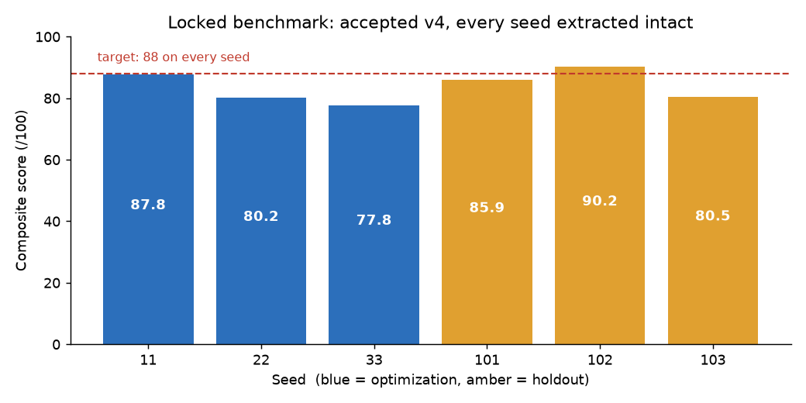
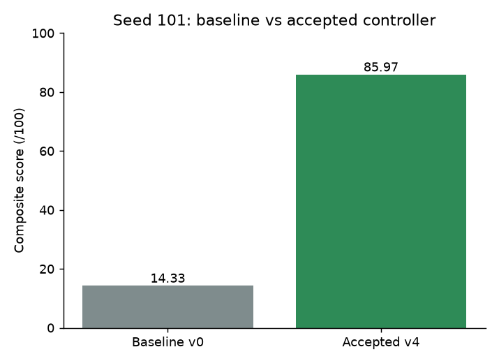
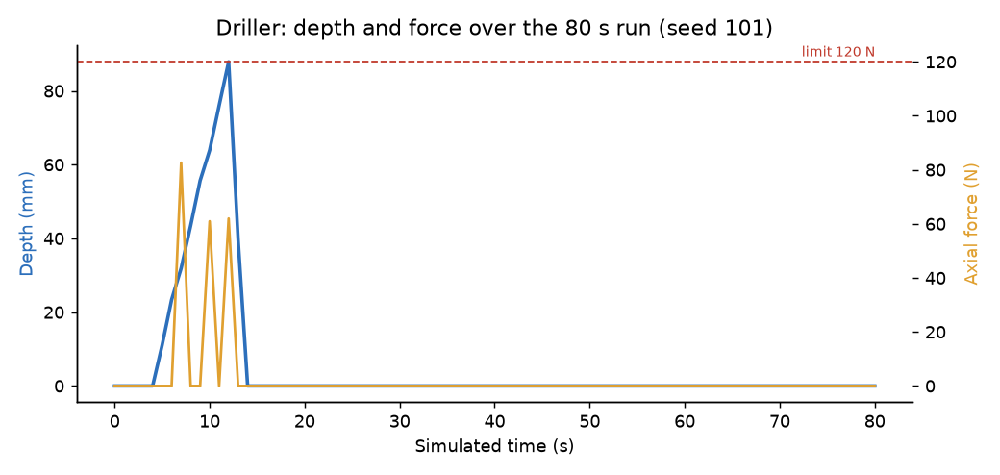
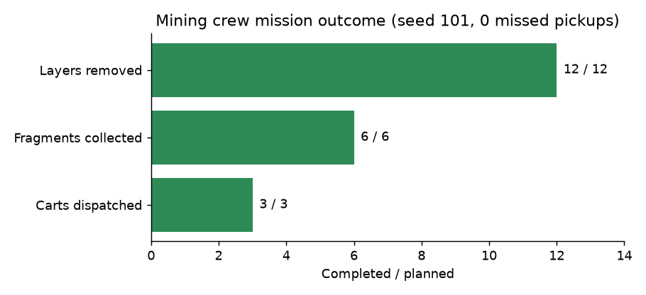
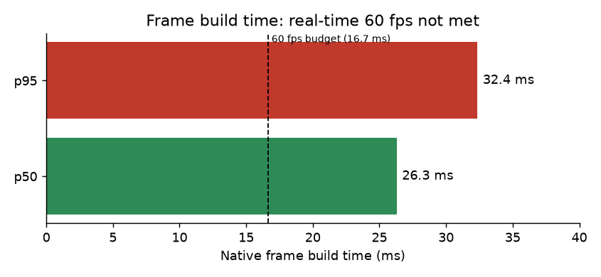

# DeepCore-N1

A self-improving robotic-excavation sandbox. A recursive agent tree — **Root Architect → CV Specialist + Excavation Control Specialist → Independent Verifier** — rewrites an RGB-D perception + control pipeline (`workspace/candidate_pipeline.py`) until a robot arm can extract a fragile cyan core from under two rubble boulders in MuJoCo without shattering it. Every candidate is scored by a **locked verifier** (`core/`, SHA-256 guarded via `core/LOCK.json`) on real physics rollouts; versions that pass the Law 5 contract are archived into a persistent shared brain.

## Live demo

- **Replay site:** https://manvendersingh21.github.io/deepcore-n1/ — the browser control room
  replaying recorded MuJoCo episodes (seed 101): baseline v0 and the accepted controller.
  Press `0` for baseline, `N` for accepted. Nothing on the page is live.
- **Mining-fleet video (80 s, native MuJoCo):** [native_realistic_fleet.mp4](https://github.com/manvendersingh21/deepcore-n1/releases/tag/demo-2026-10-17)
  (release `demo-2026-10-17`); web copy: https://manvendersingh21.github.io/deepcore-n1/fleet_demo.mp4

## Current verified status

The locked core-recovery benchmark rerun in [`dev/final_verification.json`](dev/final_verification.json)
finished **STOP_DONE**: optimization composite **81.92**, holdout **85.56**, all six
cores extracted, both boulders cleared and no shattered core. Core hashes and all
recorded source hashes matched; accepted v4 and the original ledger were unchanged.
Its historical accepted scores remain **82.02 / 85.54**. The >88 target on every
seed remains unmet (fresh holdout seed103 scored80.55).

Actual architect and specialist review operations consumed saved guidance version2.
The vision proposal passed static checks and was saved as an **unverified draft**;
the control response failed JSON parsing. Neither replaced the accepted controller.
Accepted benchmark improvements came from curated fallback patches; the earlier
LLM candidate was rejected. See [`dev/final_verification_report.md`](dev/final_verification_report.md).

The mine/cart fleet has one verified sensor-based simulation episode, seed 101, from
[`dev/native_realistic_fleet.json`](dev/native_realistic_fleet.json):

- 80 s simulated; 12/12 drill layers removed; max depth 89.0 mm; peak drill force 83.2 N.
- 6/6 fragments produced and collected from corrupted RGB-D tracks plus proprioception; 0 pickup misses.
- Three rail carts loaded to [2, 2, 2] and all dispatched.
- Collector peak force 10.7 N.
- Native frame build p50 26.3 ms / p95 32.4 ms. This is **not** real-time 60 FPS.

This is one seed in simulation. Fleet learning has **not** been run, and no fleet
promotion exists. The accepted v4 controller is still a curated fallback patch, not an
LLM-authored improvement. The >88 target on every benchmark seed remains unmet.
A separate bounded parameter learner and backend endpoint are prepared, with **53
CPU tests passing**.

## Results at a glance

Every chart is built from a saved result file. Full numbers and sources are in
[METRICS.md](METRICS.md).

### Locked benchmark (fresh run)



All six seeds extracted the core with no shattering. Four seeds are still below
the target of 88, so the target is not yet met.

### Baseline vs accepted controller (seed 101)

<p align="center"></p>

The baseline fails to extract the core. The accepted v4 controller extracts it intact.
v4 is a curated fallback from the patch library, not a model-written improvement.

### Mining crew (sensor-driven, seed 101, simulation)





The driller removes 12 of 12 layers, reaching 89 mm depth with a peak axial force of 83.2 N
against a 120 N limit. The collector picks up 6 of 6 fragments with 0 missed pickups, and all
3 carts are dispatched. This is one seed in simulation, not a physical robot.

### Frame build time



Real-time 60 fps is **not met**: p95 frame build is 32.4 ms against a 16.7 ms budget.

---

## Quickstart

```bash
python3 -m venv .venv
.venv/bin/pip install -r requirements.txt
cp .env.example .env        # optional: set CRUSOE_API_KEY for LLM-driven generations
.venv/bin/python main.py run-evolution
.venv/bin/python main.py run-hud
```

## Browser control room

From the repo checkout that will serve the browser, route simulation workers to `cis-a6000` GPU0:

```bash
DEEPCORE_GPU_HOST=cis-a6000 .venv/bin/python main.py run-web --port 8080
```

Open `http://127.0.0.1:8080` on that machine, or forward port 8080 over SSH to view it locally.
The 3D site and moving robot use the real MuJoCo scene and streamed poses; run results and learning
events come from the simulation and ledger. `run-hud` remains available as the native MuJoCo HUD.
Its `ui/mine_visuals.py` additions dress only the render scene and do not change collision
geometry, physics, or sensor data.

## CMU mine and two-machine operation

The default browser operation is **Mine + collect**. An amber mobile drill cuts rock;
a teal collector is being adapted to detect and pick physical fragments from corrupted RGB-D and load rail carts. The sensor-based collection episode on seed 101 is recorded (see Current verified status).
The surrounding cutaway is converted from the downloaded CMU Bruceton mine survey.
Use Orbit, Close-up, or Top-down to inspect the work cell and replay the measured episode.

```bash
# Native MuJoCo presentation (requires a display):
.venv/bin/python main.py run-mine --seed 101

# Native recording on cis-a6000 GPU0, with the configured EGL environment:
~/perception-loop-n1/.venv/bin/python main.py run-mine --seed 101 --out dev/demo_mining_fleet_raw.mp4

# Browser recording, after starting the control room:
node scripts/record_web_demo.mjs --run --operation fleet --out dev/demo_mining_fleet_browser.mp4
```

`ui/mining_fleet.py` is a separate cooperative demonstration. It uses actuator-driven
planar bases, contact-work rock removal, free-body fragments, and contact-conditioned
grasp constraints. The mine mesh is visual context; its source units are unknown and its
uniform display scale is documented. This is a simplified material and mobility model.
The fleet combines scripted task coordination with an RGB-D target observer; the seed-101 sensor episode above verifies that policy only for that seed. Earlier privileged-state fleet results do not verify the sensor policy. Accepted learning-loop scores belong to the separate locked core-recovery benchmark. See `dev/mining_fleet_notes.md` and
`dev/cmu_integration_notes.md` for the models and transforms.

Original model and animations: `assets/cmu_mine_reference/`. Source URLs, hashes,
and rights status are in its manifest. Regenerate derived geometry with
`.venv/bin/python -m scripts.import_cmu_mine`.

The collector uses a real six-joint, actuator-driven UR5e with per-link meshes.
The supplied `dev/robotic_arm.glb` was inspected and converted into 138 rigid parts,
but has no authored joint rig; it is prepared as a reference and does not replace
the working articulated robot. See `dev/user_arm_import_notes.md`.

The browser includes cart load/force displays and `/api/fleet-learn` wiring. The
prepared learning command below evaluates actual fresh baseline/candidate fleet
runs and stores a separate fleet ledger; it never promotes core benchmark code:

```bash
.venv/bin/python -m scripts.learn_fleet --seeds 11 22 33
# --no-llm uses measured-failure parameter adaptation instead of a real model proposal.
```

Wait until fleet camera/perception debugging finishes before running this GPU
workflow. No real fleet learning promotion has been recorded. The current local
server on port62001 still has an older preview and needs restarting after sync;
final browser/native demo recording is pending.

## Not included in this repo

- **CMU Bruceton mine survey data:** license unspecified, so it is not committed. Fetch it
  with `scripts/import_cmu_mine.py` using the URLs and hashes in `assets/cmu_mine_reference/manifest.json`.
- **User-supplied third-party arm model** (`dev/robotic_arm.glb`, `assets/robot_reference/user_arm/`): not redistributed.
- **Agent transcripts and logs:** excluded.

Rebuild the static site: `.venv/bin/python -m scripts.static_site.build`

## Physical deployment

This is a simulator. Nothing here has been validated on real hardware, and the
"deployment" is the simulation and the static replay site above.

## Commands

| command | what it does |
|---|---|
| `main.py run-evolution [--iterations 3] [--verify-improvement] [--reset]` | Registers the v0 baseline (if needed), runs N generations of the contract tree, prints a table per generation (version, source, opt/holdout composite, RMSE, peak core force, extracted, accepted). Exit 1 if `--verify-improvement` fails. |
| `main.py run-hud [--seed N]` | 1600x900 live HUD: corrupted overhead view + CV overlay, 3rd-person view with force arrow, contract rail, agent tree, v0-vs-best scoreboard from the ledger. Hotkeys: `0-3` versions, `E` evolve, `W` webcam occlusion, `R` reseed, `Q`/`ESC` quit. |
| `main.py run-web [--host 127.0.0.1] [--port 8080]` | Starts the interactive browser control room. Set `DEEPCORE_GPU_HOST=cis-a6000` to run physics on the remote GPU host. |
| `main.py run-mine [--seed 101] [--out video.mp4]` | Two moving robots in the CMU mine cutaway; native window or measured episode recording. |
| `main.py run-drill [--seed 101]` | Independent drilling with measured force, torque, depth and RPM. |
| `main.py verify-all` | Verifies `core/` integrity hashes, re-evaluates `workspace/candidate_pipeline.py` on optimization seeds (11, 22, 33) and holdout seeds (101, 102, 103), prints both aggregates and the Law 5 verdict against the previous accepted version. |
| `main.py record-demo [--out submission_demo.mp4] [--seconds 60]` | Records independent real drilling, baseline recovery, ledger recap and accepted recovery segments. The final updated demo remains unrecorded. |
| `python -m scripts.finalize_verification --review-agents` | Saves actual unverified agent drafts, then reruns the accepted benchmark against the prior accepted version and frozen mission; writes evidence without changing the ledger. |
| `python -m scripts.learn_fleet [--seeds 11 22 33] [--no-llm]` | Fresh sensor-based fleet parameter trial and separate ledger; requires stable perception and an allocated rendering GPU. |

To capture the browser control room, start `run-web` first, install Playwright (the recorder also
checks `/tmp/deepcore-web-deps/node_modules/playwright`), then run `node scripts/record_web_demo.mjs`.
It replays a completed or running episode by default; pass `--run` to have it start real baseline
and candidate runs before recording. MP4 output also needs ffmpeg with `libx264`; WebM segments
are retained in either case.

## Architecture

```
deepcore-n1/
├── main.py               # this CLI
├── core/                 # LOCKED judge (SHA-256 in core/LOCK.json): scene.xml, env_runner,
│                         # sensor_corruption, verifier_harness, integrity
├── agents/               # crusoe_client (LLM + fallback patches), sandbox_exec, contract_orchestrator
├── shared_brain/         # ledger.json, playbook.md, brain.db — persistent memory of the tree
├── workspace/            # candidate_pipeline.py + archived versions/v<N>.py
├── ui/                   # live_hud: 1600x900 OpenCV HUD
├── scripts/              # record_demo: submission video from real rollouts + ledger
└── tests/                # pytest suites
```

## The Law 5 contract

A candidate Version N+1 is accepted only if (`core/verifier_harness.check_contract`):

- opt-set composite score **strictly improves** over the previous accepted version;
- holdout composite score does **not decrease**;
- max wrist force **< 28 N** on both optimization and holdout seeds;
- vision latency p99 **< 25 ms** on both splits;
- the core is **never shattered** (fracture at 18 N gated core contact force).

## Honest note on generations

The loop runs with or without an LLM key. Without `CRUSOE_API_KEY` (or on any LLM/network failure), every generation comes from the deterministic, curated fallback patch library and is labelled `fallback_patch:<name>` in `shared_brain/ledger.json`. All numbers — fallback or LLM — are always measured by the same locked verifier on real MuJoCo episodes; nothing is mocked or hardcoded.
